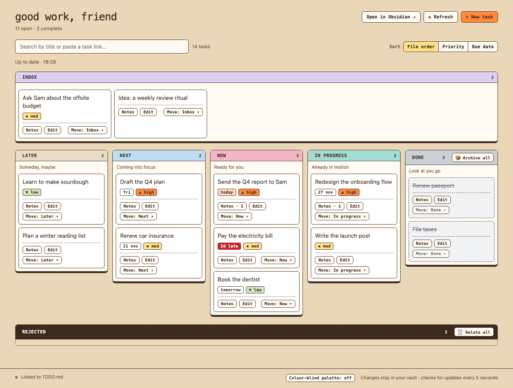
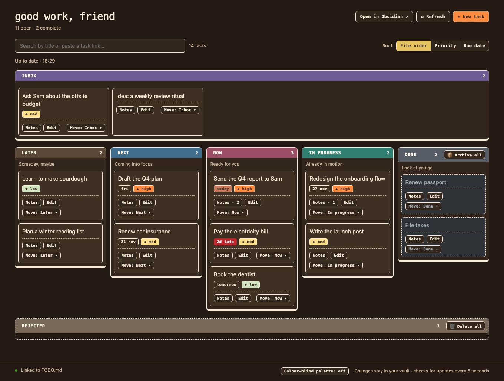

# Good work, friend: a task board for your Obsidian vault

A small kanban board that lives on top of a single `TODO.md` file. Drag a card,
and the file changes. Edit the file in Obsidian, and the board follows.

- No install step, no account, no database. It needs Node.js 18 or later.
- Runs on your computer only. Nothing leaves your vault.
- Your Markdown is the source of truth, so the board is just a view.



The board follows your system's light or dark setting.

<details>
<summary>See dark mode</summary>



</details>

## Try the sample

Open a terminal in this folder and run:

```sh
bash start.sh
```

The board opens in your browser and saves changes to the sample `TODO.md` in
this folder. Press Ctrl+C to stop it.

## Connect your vault

1. Back up your vault and your existing `TODO.md`.
2. Put a `TODO.md` at the root of your vault in the format below.
3. Run the app with your vault folder (keep the quotes if the path has spaces):

   ```sh
   bash start.sh "/path/to/your/vault"
   ```

The terminal shows which `TODO.md` will receive changes. The app does not
convert existing files.

Links that open Obsidian (Open in Obsidian, and the task and note links) use
your vault's folder name as its name. If you gave the vault a different name in
Obsidian, those links will not open until the names match.

## Set it up with an AI assistant

Not sure how to bring your own tasks over? Give this prompt to an AI assistant
that can read and write files on your computer (for example Claude Code,
Codex, or Cursor), after you have cloned this repo. It makes the assistant back
up first, show you a plan, and only then change anything.

```text
I want to use the "Good work, friend" task board with my Obsidian vault. The
board is in the folder I cloned from https://github.com/jaycativo/task-board-app.
Please set it up for me, carefully.

First read README.md in that folder, especially "The TODO.md format" and "Notes".

1. Back up first. Copy my vault, or at least my existing TODO.md and task
   notes, to a backup folder and tell me where it is. Change nothing before
   this is done.
2. Look at how I track tasks today: any TODO.md, task lists, or checkbox
   notes. Do not edit anything yet.
3. Show me a plan and wait for my OK. It should say how my existing statuses
   map to Inbox, Backlog, Next, Now, In Progress, and Done, which tasks get
   new IDs, and what you will leave alone.
4. Once I agree, create or convert TODO.md at the root of my vault in exactly
   the board's format: both collector markers, the six headings, and Done after
   the end marker. Keep every task's text and its indented details. Give each
   task a unique ^task-... ID. Only write due dates (📅 YYYY-MM-DD) and
   priorities (⏫ 🔼 🔽) if I already track them. Do not touch my other notes.
5. Read .obsidian/daily-notes.json and tell me which folder task notes will be
   saved to. If my date format is not YYYY-MM-DD, tell me and suggest the
   --notes-folder option.
6. Check that Node.js 18 or later is installed. Test on a copy of my vault
   first: start the board with bash start.sh "<path to the copy>", move one
   card, add one task, and confirm the file looks right. Then show me how to
   start it on my real vault.
7. Tell me exactly what you changed, what you left alone, and the command to
   start the board next time.

Rules: never delete my content, never run anything on my real vault before the
backup exists, and ask me if anything is unclear.
```

## What the board does

- **Move tasks** by dragging a card or using its Move menu, which lists every
  column including Rejected.
- **Add tasks** with the New task button. They land in Inbox.
- **Edit or delete tasks** with a card's Edit button. You can change the title,
  due date, and priority, or delete the task. Indented details under the task
  and any other tokens on the line (like a repeat rule) are kept.
- **Archive finished work.** The Archive all button on Done moves every done
  task to `TASK-ARCHIVE.md` at the vault root, under a dated heading, and takes
  them off the board. The archive keeps each task's details and adds a `✅`
  completion date if it has none.
- **Due dates and priorities.** Cards show a friendly due label (`today`,
  `tomorrow`, `fri`, `20 nov`, `2d late`) and a priority (`▲ high`, `◆ med`,
  `▼ low`). Priority uses a shape and a word as well as a colour, and a footer
  toggle switches to a colour-blind-friendly palette.
- **Reject tasks** you decide against with Move, then Rejected. They go to a
  collapsed Rejected panel under the board, where you can restore them to Inbox
  or delete them all with the trash button.
- **Sort** each column by file order, priority, or due date. High priority and
  the earliest due date come first, and tasks with neither go last. Sorting only
  changes how cards are shown: your file keeps its own order, and the board
  remembers your choice.
- **Search** by title, ID, priority, date, or a pasted `[[TODO#^task-id]]` link.
- **Task notes.** A card's Notes button opens a drawer with that task's notes,
  newest first, and a box to add one. The card shows how many notes it has.
  Notes you added in the board can be edited or deleted there. Notes you wrote
  by hand in Obsidian are listed too, marked "written in Obsidian", and stay
  read-only.

## The `TODO.md` format

```md
<!-- todo-collector:start -->
## Inbox
- [ ] Try the board ^task-try-board

## Backlog
## Next
## Now
- [ ] Send the report ⏫ 📅 2026-11-14 ^task-send-report

## In Progress

<!-- todo-collector:end -->

## Done
- [x] Start with a small problem ^task-small-problem
```

- Keep the two collector markers and the Inbox, Backlog, Next, Now,
  In Progress, and Done headings. Done must come after the end marker.
- Due dates and priorities use the [Obsidian Tasks](https://publish.obsidian.md/tasks/)
  emoji format: `📅 YYYY-MM-DD` for a due date, and `⏫` high, `🔼` medium,
  `🔽` low for priority. The board changes only these tokens and leaves
  everything else on the line, including indented details, untouched.
- Give tasks a unique block ID such as `^task-first`. Tasks made in the board
  get one automatically, and a task without one gets one the first time you edit it.
- The first rejection adds a `## Rejected` heading at the end of the file.
  Rejected tasks are written as `- [-]`, which the Tasks plugin treats as
  cancelled.
- Tasks outside the markers are ignored, and a `## Suggestions` heading from
  older versions is ignored too.

## Notes

Task notes are saved in your daily notes folder as dated files
(`YYYY-MM-DD.md`), linked back to the task with `[[TODO#^task-id]]`, using your
computer's time zone. The board finds the folder like this:

1. `--notes-folder`, if you pass it: `bash start.sh "/path/to/vault" --notes-folder journal`
2. Otherwise the folder in your Obsidian daily notes settings
   (`.obsidian/daily-notes.json`). The board says which folder it picked when
   it starts.
3. Otherwise `Daily Notes/`, which it creates.

Only the `YYYY-MM-DD` date format is supported. If your daily notes use another
format, the board falls back to `Daily Notes/` and tells you so.

The board checks for file changes before saving, but it does not share a lock
with Obsidian. Avoid saving the same file in both apps at the same moment.

## Building on it

Agent instructions live in `AGENTS.md`, and task-specific skills (adding a
feature, the file format, server safety, the design system, running and
verifying) live in `.agents/skills/`. They are written for any coding
assistant, and for people too.

## Tests

```sh
node --test task-board/*.test.mjs
```

## Status

Work in progress.

Good to know: deleting or archiving a task does not touch its notes. Notes link
to `[[TODO#^task-id]]`, so a link to an archived task stops resolving until the
task is back in `TODO.md`.

## Licence

[MIT](LICENSE). Use it, change it, share it.
